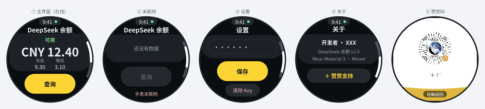

# DeepSeek 余额 · Wear OS

一个跑在 Wear OS 手表上的 DeepSeek 余额查看器。纯 Kotlin + Jetpack Compose，界面对齐 **Material 3 Expressive（M3E）**：Monet 动态取色、变形列表、极坐标弧形菜单。

<p align="center">
  
</p>

## 功能

- **余额查询**：调用 `GET https://api.deepseek.com/user/balance`，显示总余额、充值余额、赠送余额、可用状态。
- **四页结构**：余额 / 设置 / 关于 / 赞赏，`HorizontalPager` 承载，左右不误触。
- **M3E 弧形悬浮菜单**：从屏幕中心左滑，四个圆形按钮以极坐标沿 -45°~45° 弹出，50ms 错峰 + `MediumBouncy` 弹簧。
- **变形列表**：`TransformingLazyColumn` + `SurfaceTransformation`，卡片滚动到中间放大、到边缘收窄。
- **Monet 取色**：Android 12+ 读取系统壁纸主色，低于 12 回退到内置深色方案。
- **官方滚动指示器**：每页独立显示当前列表的滚动位置。
- **旋钮支持**：`flingBehavior` 与 `rotaryScrollableBehavior` 成对配置，表冠滚动带吸附。
- **联网检测**：Horologist `NetworkRepository`，无网时查询按钮置灰并提示。

## 截图

| 余额 | 弧形菜单 |
|---|---|
| _(待补充真机截图)_ | _(待补充真机截图)_ |

## 安装

从 [Releases](../../releases) 下载 APK，手表上 `adb install`，或用手机端 Wear OS 应用配对安装。

```bash
adb install -r DeepSeekBalance-wear.apk
```

要求 Wear OS 3.0+（`minSdk 30`）。

## 使用

1. 首次启动会自动跳到「设置」页。
2. 填入 DeepSeek API Key（在 [platform.deepseek.com](https://platform.deepseek.com/api_keys) 创建），点保存。
3. 回到「余额」页点「查询」。

API Key 只存在手表本地的 `SharedPreferences`，不做任何上传，也不会写进日志。

## 从源码构建

需要 JDK 17、Android SDK 35。

```bash
git clone https://github.com/a17xyh-hash/DeepSeekBalance-Wear.git
cd DeepSeekBalance-Wear
./gradlew :wear:assembleRelease
# 产物：wear/build/outputs/apk/release/
```

`phone/` 是配套的手机端模块（可选，不影响手表端）。

## 技术栈

| 组件 | 版本 |
|---|---|
| Kotlin | 2.1.0 |
| AGP | 8.7.2 |
| compileSdk / minSdk | 35 / 30 |
| Compose BOM | 2025.05.01 |
| Wear Compose Material3 | 1.6.0 |
| Horologist | 0.7.15 |

关键的 `TransformingLazyColumn` / `SurfaceTransformation` / `ScreenScaffold` 均来自官方 Wear Compose M3，没有用第三方 UI 库。

## 目录结构

```
wear/src/main/java/com/example/dsbalance/wear/
├── MainActivity.kt    主题、4 个页面、弧形菜单、手势
├── NcmIcons.kt        42 个手绘 24×24 矢量图标（by lazy）
└── BalanceApi.kt      余额接口封装（HttpURLConnection + org.json）
```

## 已知限制

- 界面按圆形表盘设计，方形表盘边缘会有留白。
- 余额查询需要手表自身可联网（Wi-Fi 或蜂窝），不支持经手机代理转发。
- 未做后台刷新与表盘 Complication。

## 开源协议

[MIT](LICENSE)。

图标为项目手绘矢量，视觉风格参考了 [windzhou999/netmusiclite](https://github.com/windzhou999/netmusiclite)，未直接复制其资源文件。

## 致谢

- [androidx/androidx](https://github.com/androidx/androidx) — Wear Compose Material3
- [google/horologist](https://github.com/google/horologist) — 网络状态监听
- [DeepSeek 开放平台](https://platform.deepseek.com) — 余额接口
